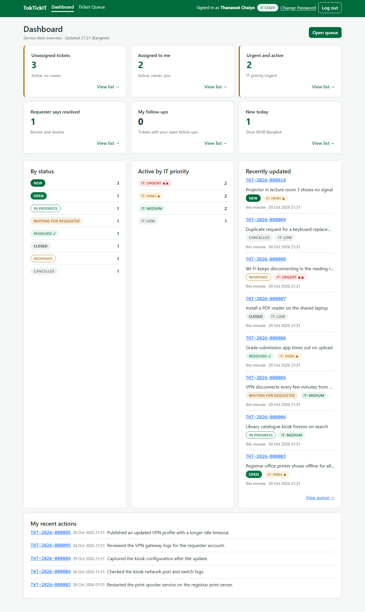
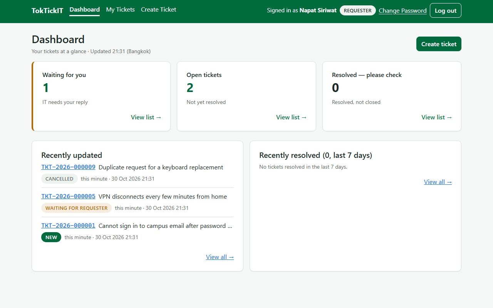

# Lab 4 — Dashboard Metrics Against the Database

Evidence for `ui-spec.md` §13 ("Selected metrics match database queries") and the Definition of Done demonstration of
accurate counts. Each dashboard was opened in a browser and screenshotted. The SQL below was then run against the same
database, in the same moment, by the same script. The SQL was written for this check and does not reuse the
application's Prisma queries, so it is an independent count.

- **Captured:** 2026-10-30T14:31:32.887Z (UTC), on a freshly migrated and seeded database (README setup). Anyone can
  reproduce the same numbers with `npx prisma migrate deploy` and `npx prisma db seed`, except "New today", which
  counts what was created on the day the database was seeded.
- **Script:** a one-off Playwright capture that reads each card's number from its accessible name
  ("Unassigned tickets: 3. View list"), reads each By status row from the page, runs the SQL through the server's own
  database connection, and fails if any pair differs. It is not part of the suite.

## IT Staff dashboard — Thanawat Chaiyo



| Card | Dashboard shows | SQL counts | Match |
|---|---|---|---|
| Unassigned tickets | 3 | 3 | ✅ |
| Assigned to me | 2 | 2 | ✅ |
| Urgent and active | 2 | 2 | ✅ |
| Requester says resolved | 1 | 1 | ✅ |
| My follow-ups | 0 | 0 | ✅ |
| New today | 1 | 1 | ✅ |
| By status: NEW | 3 | 3 | ✅ |
| By status: OPEN | 1 | 1 | ✅ |
| By status: IN_PROGRESS | 1 | 1 | ✅ |
| By status: WAITING_FOR_REQUESTER | 1 | 1 | ✅ |
| By status: RESOLVED | 1 | 1 | ✅ |
| By status: CLOSED | 1 | 1 | ✅ |
| By status: REOPENED | 1 | 1 | ✅ |
| By status: CANCELLED | 1 | 1 | ✅ |

```sql
-- Unassigned tickets
SELECT count(*)::int AS n FROM "Ticket" WHERE status IN ('NEW','OPEN','IN_PROGRESS','WAITING_FOR_REQUESTER','REOPENED') AND "assigneeId" IS NULL;

-- Assigned to me
SELECT count(*)::int AS n FROM "Ticket" WHERE status IN ('NEW','OPEN','IN_PROGRESS','WAITING_FOR_REQUESTER','REOPENED') AND "assigneeId" = (SELECT id FROM "User" WHERE email = 'thanawat.it@toktickit.dev');

-- Urgent and active
SELECT count(*)::int AS n FROM "Ticket" WHERE status IN ('NEW','OPEN','IN_PROGRESS','WAITING_FOR_REQUESTER','REOPENED') AND "itPriority" = 'URGENT';

-- Requester says resolved
SELECT count(*)::int AS n FROM "Ticket" WHERE status IN ('NEW','OPEN','IN_PROGRESS','WAITING_FOR_REQUESTER','REOPENED') AND "requesterResolvedFlaggedAt" IS NOT NULL;

-- My follow-ups
SELECT count(DISTINCT t.id)::int AS n FROM "Ticket" t JOIN "ActionTaken" a ON a."ticketId" = t.id WHERE t.status <> 'CANCELLED' AND a."performedById" = (SELECT id FROM "User" WHERE email = 'thanawat.it@toktickit.dev') AND a."followUpRequired" AND a."followUpCompletedAt" IS NULL AND a."voidedAt" IS NULL;

-- New today
SELECT count(*)::int AS n FROM "Ticket" WHERE "createdAt" >= (date_trunc('day', now() AT TIME ZONE 'Asia/Bangkok') AT TIME ZONE 'Asia/Bangkok');

-- By status (zero-filled for statuses with no row)
SELECT status::text AS status, count(*)::int AS n FROM "Ticket" GROUP BY status ORDER BY status;
```

```text
CANCELLED              1
CLOSED                 1
IN_PROGRESS            1
NEW                    3
OPEN                   1
REOPENED               1
RESOLVED               1
WAITING_FOR_REQUESTER  1
```

## Requester dashboard — Napat Siriwat



| Card | Dashboard shows | SQL counts | Match |
|---|---|---|---|
| Waiting for you | 1 | 1 | ✅ |
| Open tickets | 2 | 2 | ✅ |
| Resolved — please check | 0 | 0 | ✅ |

```sql
-- Waiting for you
SELECT count(*)::int AS n FROM "Ticket" WHERE "requesterId" = (SELECT id FROM "User" WHERE email = 'napat.s@toktickit.dev') AND status = 'WAITING_FOR_REQUESTER';

-- Open tickets
SELECT count(*)::int AS n FROM "Ticket" WHERE "requesterId" = (SELECT id FROM "User" WHERE email = 'napat.s@toktickit.dev') AND status IN ('NEW','OPEN','IN_PROGRESS','WAITING_FOR_REQUESTER','REOPENED');

-- Resolved — please check
SELECT count(*)::int AS n FROM "Ticket" WHERE "requesterId" = (SELECT id FROM "User" WHERE email = 'napat.s@toktickit.dev') AND status = 'RESOLVED';
```

Every pair matched. The same equality is also asserted on every run by API-43 – API-44 and API-51 – API-53 against
seeded data, and by E2E-09 and E2E-10, which compare each card with the list it opens.
